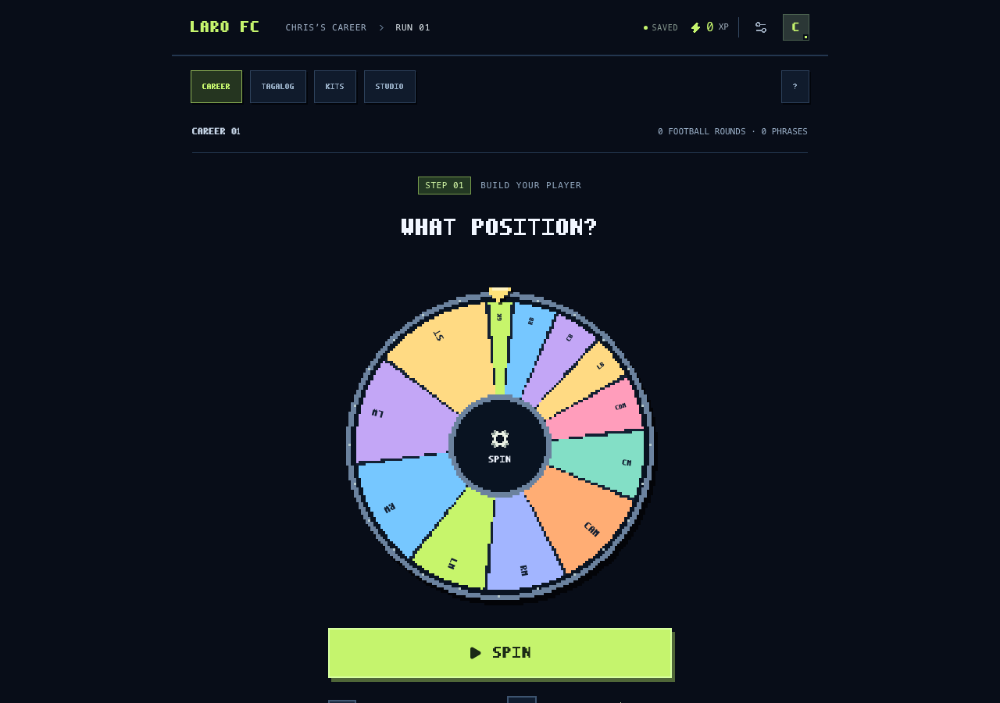
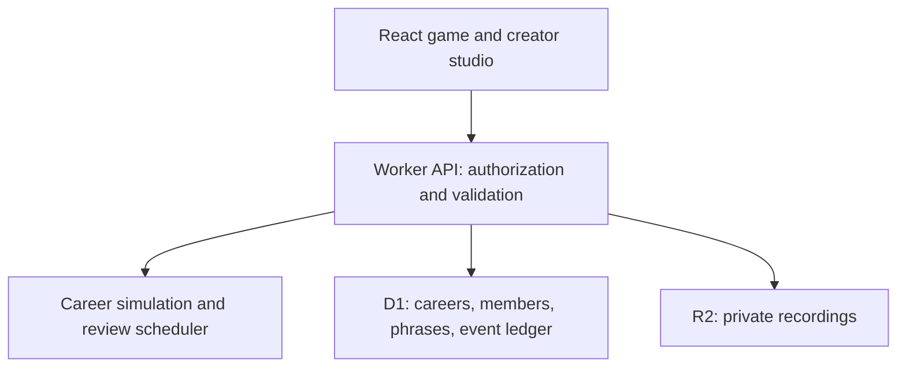

# Laro FC

A full-stack Tagalog learning app built around a soccer career simulator. Made for Chris, a Korean American learner from NY/NJ, by his Filipina partner Shelomi.

**Play it:** [laro-fc.jnd11.workers.dev](https://laro-fc.jnd11.workers.dev). No sign-up needed; each browser gets its own guest career.



Each round follows the full career builder: position, nationality, debut age, height, career length, attributes, dominant foot, clubs, upgrades, domestic and European competitions, international results, goals, assists, and individual awards. Conditional follow-up questions reflect earlier results. The wheel shows the possible answers and the backend applies the selected result; numeric goal and assist totals use an animated counter. The run ends with a career card rather than an arbitrary spin limit.

Each attribute round is followed by a Tagalog training question: a correct answer raises that attribute by one point. A Tagalog checkpoint comes every third round, and every correct answer charges a few "lucky" spins that lean the next wheels toward good outcomes. Exercises are all multiple choice and always carry context: picking the meaning of a Tagalog phrase, picking what you would say in a short situation, filling in a missing word with the English meaning shown (the blank lands on a word worth learning, and the wrong options are the same kind of word), and ordering the words of a phrase you already know well. Difficulty rises gently over a career and from one career to the next; checkpoints only ask the two easiest kinds. A miss removes the wrong choice and reveals a hint, never the answer. The quiz screen shows the current level.

New careers use deliberately unrealistic "fun" rules: ranked wheels lean toward the good end, the Philippines and South Korea are football superpowers, and before each new club a plot-twist wheel can send the player straight to a giant club. League titles at a club never exceed the seasons spent there. Checkpoint wheels show categories rather than full phrases. The quiz removes the career screen, wheel, and recent history from the rendered page, and hides the English gloss and usage explanation until the answer is correct, including after mistakes. The phrasebook remains available for studying.

## Included

- Persistent career runs, position-specific attributes, club histories, eleven trophy categories, event history, XP, and kit unlocks.
- A trophy cabinet for the current career and for every career combined, and a one-tap restart with quick Philippines and South Korea starts.
- Manual spins with an explicit next-question step, auto-spin, two speeds, and reduced motion. Auto-spin pauses for Tagalog and stops at the completed career card.
- Local Web Audio synthesis: original lo-fi music with a different song for spinning, quizzes, goals, the plot twist and the menus, plus wheel ticks, jingles and answer sounds. Audio starts after a user gesture; music and sound effects can be turned off separately.
- An animated pixel-art world: a volcano, rice terraces, drifting clouds, a passing jeepney, parol lanterns, a keeper who shuffles during quizzes, and fireworks when you score.
- Hyung glasses mode: larger text and a dimmer background, and everyone in the scene wears glasses.
- The Wire: live Manchester United headlines from BBC Sport's public RSS feed, grouped into storylines by the names that recur and drawn as a transit map over time, with new-since-last-visit markers and Taglish reactions picked from each headline's tone. Grouping and tone are word-based heuristics.
- Football-culture details on every career: a role from the player's attributes (regista, inverted winger, false 9, Raumdeuter), a traditional shirt number, derby defections called out when they happen (El Clásico, the Old Firm, the Hudson River derby), homecomings, and a career verdict.
- A pixel arcade layout with a 128×128 canvas wheel, self-hosted pixel font, square controls, larger question and result headings, and readable body text. Wheel angles reflect the backend weights; blocked outcomes cannot be selected.
- Eighty-four built-in phrases with meanings, usage context, and tap-a-word breakdowns, including lambing, family references, and PBB’s Kuya.
- A phrasebook and creator studio with audio recording or file upload.
- The home page shows the landing page to new visitors and the game to returning players; the game is always at `/play`.
- Offline support: after one online visit, the saved career, trophies, phrasebook and landing page open without a connection (`public/sw.js`). Spins and quizzes need the server and say so when offline.
- First-party analytics (`lib/analytics.ts`, `app/track.ts`): page views, waitlist signups, first plays, spins, quiz answers, finished careers, restarts and installs, keyed by a random device ID with no email, name or IP address. Events recorded offline are queued on the device and sent with their original times on reconnect; each event has an ID so repeats are stored once, and each device is capped per day. A founder dashboard at `/stats` shows aggregate numbers only and requires the `STATS_KEY` Worker secret (`npx wrangler secret put STATS_KEY --name <worker>`), passed as `/stats#key=…`.
- A landing page at `/welcome` with a waitlist. Signups store only the email, two short answers and an optional `ref`/`utm_source` tag; each signup can remove itself right after joining. List them with `npx wrangler d1 execute laro --remote --command "SELECT email, learning_for, role, source, datetime(created/1000,'unixepoch') FROM waitlist ORDER BY created DESC"`.
- Creator/learner invitations, with server-side role checks and private audio access.
- Optimistic concurrency checks and idempotent mutations that prevent duplicated rewards.
- Automatic review scheduling, with higher selection weights for overdue and weak phrases.

## Architecture

React + TypeScript run on the Vinext app router. API routes execute on Cloudflare Workers. Cloudflare D1 stores careers, clubs, memberships, custom phrases, and mutation records. R2 holds audio objects. On the managed host, sign-in comes from that host and signed-in visitors use their stable site-specific user ID. Anonymous visitors, and every visitor on a self-hosted copy, use an opaque HttpOnly device cookie.



Career mutations compare the expected version with the stored version. A D1 batch atomically updates the career and inserts an idempotency record only when the update succeeds. Stale clients receive a conflict response and reload. Replayed request IDs return the saved result without awarding additional XP. Answer correctness and kit eligibility are validated on the server.

`lib/player-career.js` holds the career questions and their probability rules. Each request reconstructs its own simulation from a career seed and recorded choices. Replay validates stage IDs and available outcomes, and there is no mutable simulation state shared between careers. The TypeScript declaration exposes a typed boundary to the API and UI. Each event records the exact question, weights, and selected index for animation.

An invite grants learner membership in the selected career, not creator permissions. Audio requests must belong to the requester's current club. Site-level sharing is a separate access boundary: the initial deployment is owner-private, so Chris needs site access before an in-app invite works.

### Where to look

| Path | What it does |
| --- | --- |
| `lib/engine.ts` | Grades exercises, schedules review, awards XP, and connects the career simulator to the game. |
| `lib/catalog.ts`, `lib/phrase-guide.ts` | The phrases and their word-by-word notes. |
| `lib/player-career.js`, `lib/player-career-v1.js`, `lib/player-career-v2.js` | The seeded career builder and its branching questions; v1 and v2 are frozen copies for older saves. |
| `lib/server.ts`, `app/api/[...route]/route.ts` | Identity, membership, atomic saves, and the HTTP API. |
| `app/game.tsx`, `app/art.tsx` | The game UI, quiz, phrasebook, studio, The Wire, trophy cabinet, pixel art, and weighted wheel. |
| `lib/arcade.ts` | The music and sound effects, synthesized with Web Audio. |
| `lib/united.ts`, `lib/newsdesk.ts` | Fetching United headlines and grouping them into storylines. |

`components/ui/`, `vendor/`, and most of `scripts/` are framework and hosting scaffolding. `app/game.tsx`, `app/art.tsx`, `app/globals.css`, and `lib/player-career-v1.js` were recovered from a compiled deployment, so their local names are short and the stylesheet is compiled.

## Local development

Requires Node.js 22.13+ and the lockfile's package manager.

1. Install dependencies with `pnpm install --frozen-lockfile`.
2. Run `pnpm build` to emit the local Worker configuration.
3. Apply each pending SQL migration once, in order:

   ```sh
   node --import ./scripts/sites-env.mjs ./node_modules/wrangler/bin/wrangler.js d1 execute DB --local --config dist/server/wrangler.json --persist-to .wrangler/state --file drizzle/0000_sticky_vengeance.sql
   ```

4. Run `pnpm dev` and open http://localhost:5173.

The database bindings are declared in `.openai/hosting.json`. Deployments apply the committed Drizzle migrations. No LLM API key or external paid service is needed.

## Deploy a public copy to Cloudflare

The app runs anonymously without the managed host's sign-in (visitors get an opaque device cookie), so it can be deployed to any Cloudflare account. Requires Node.js 22.13+.

```sh
pnpm install --frozen-lockfile
npx wrangler login
npx wrangler d1 create laro              # copy the database_id it prints
npx wrangler r2 bucket create laro-audio
pnpm build
LARO_D1_ID=<database_id> LARO_R2_BUCKET=laro-audio LARO_APPLY_SCHEMA=1 node scripts/deploy-cloudflare.mjs
```

Later deploys: `pnpm build && LARO_D1_ID=<database_id> node scripts/deploy-cloudflare.mjs` (omit `LARO_APPLY_SCHEMA`). Wrangler prints the public `*.workers.dev` URL at the end. Add `LARO_DRY_RUN=1` to bundle and validate without changing your Cloudflare account.

The managed host's "sign in with ChatGPT" route is not available on a self-hosted copy; everything else works anonymously. The deploy script sets `LARO_DISABLE_HOST_AUTH=1` so the Worker ignores the host's identity header, which anyone could forge without that host in front of it.

## Checks

```sh
pnpm typecheck
pnpm test
```

The domain suite checks quiz answer visibility, wrong-answer scoring, review scheduling, weighted wheel geometry, deterministic replay, request isolation, and complete career runs across thirty seeds. The identity suite checks forged-header and origin handling. The SQLite suite verifies the real schema, atomic reward updates, request replay, and membership constraints.

`tests/integration.mjs` exercises the real HTTP API against an isolated development database, creating disposable test careers. It covers duplicate requests, simultaneous spins, scoring, continuation, audio uploads and isolation, invitations, role enforcement, kit gating, and malformed requests. Run it only against a test instance, with `pnpm dev` running:

```sh
LARO_TEST_URL=http://localhost:5173 node tests/integration.mjs
```

## Audio and learning scope

No generated audio is represented as Shelomi's voice. Starter phrases use a Filipino device voice only when one is installed. Real recordings uploaded in the studio take precedence. Microphone recording requires browser permission and a secure context; uploads work without microphone permission.

Scoring is standard: every correct Tagalog answer earns 100 XP. A wrong answer leads to a penalty shot at a keeper sliding across the goal: a bullseye costs nothing, hitting his body costs 100 XP and a miss costs 200 XP, and XP never goes below zero. The shot result is reported by the client, so it is a game mechanic, not a security boundary. Career results pay modest XP so the Tagalog stays the main way to earn it. Review intervals are deliberately transparent: a missed-then-correct phrase returns after five minutes; first-try successes advance through four hours, one day, three days, and seven days. Exercise selection is heuristic. Three consecutive first-try successes is shown as practice progress, not a claim of fluency.

## Saved-career compatibility

Careers replay from recorded answers, so the questions are versioned (`CAREER_RULES` in `lib/engine.ts`). A career started under the original questions keeps replaying `lib/player-career-v1.js`, one started under the realistic rules keeps replaying `lib/player-career-v2.js`, and the fun rules in `lib/player-career.js` apply to careers started afterward. Lucky spins only reweight outcomes that could already land, so replays never depend on them. Attributes and overall rating display as unknown until the corresponding builder questions are resolved. Pending older recall exercises are upgraded to Tagalog cues while preserving their attempt count.

## Next development steps

Validate phrase understanding and delayed recall with Chris, add richer lesson authoring and accessibility testing, and support recoverable guest-to-account migration before a public launch. No email, external notifications, payments, or AI model calls are involved in this version. The only outside request is the Worker fetching BBC Sport's public Manchester United RSS feed, cached for 15 minutes.
