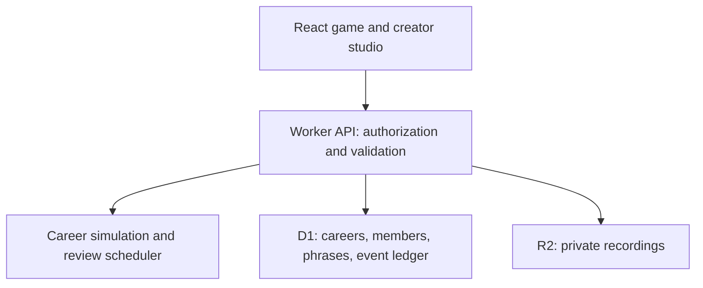

# Laro FC

A full-stack Tagalog learning app built around a soccer career simulator. Made for Chris, a Korean American learner from NY/NJ, by his Filipina partner Shelomi.

Each round follows the full career builder supplied by the user: position, nationality, debut age, height, career length, attributes, dominant foot, clubs, upgrades, domestic and European competitions, international results, goals, assists, and individual awards. Conditional follow-up questions reflect earlier results. The wheel shows the possible answers and the backend applies the selected result; numeric goal and assist totals use an animated counter. The run ends with a career card rather than an arbitrary spin limit.

Every fourth spin pauses for Tagalog. New phrases start with meaning recognition, successful reviews introduce missing-word recall in Tagalog, and repeated correct reviews unlock word ordering. Checkpoint wheels show categories rather than full phrases. The quiz removes the career screen, wheel, and recent history from the rendered page, and hides the English gloss and usage explanation until the answer is correct, including after mistakes. The phrasebook remains available for studying.

## Included

- Persistent career runs, position-specific attributes, club histories, eleven trophy categories, event history, XP, and kit unlocks.
- Manual spins with an explicit next-question step, auto-spin, two speeds, and reduced motion. Auto-spin pauses for Tagalog and stops at the completed career card.
- Local Web Audio synthesis: decelerating wheel ticks, result jingles, trophy fanfares, and answer sounds. Sound starts after a user gesture and can be muted.
- A pixel arcade layout with a 128×128 canvas wheel, self-hosted pixel font, square controls, larger question and result headings, and readable body text. Wheel angles reflect the backend weights; blocked outcomes cannot be selected.
- Fifteen starter phrases with meanings and usage context, including lambing, family references, and PBB’s Kuya.
- A phrasebook and creator studio with audio recording or file upload.
- Creator/learner invitations, with server-side role checks and private audio access.
- Optimistic concurrency checks and idempotent mutations that prevent duplicated rewards.
- Automatic review scheduling, with higher selection weights for overdue and weak phrases.

## Architecture

React + TypeScript run on the Vinext app router. API routes execute on Cloudflare Workers. Cloudflare D1 stores careers, clubs, memberships, custom phrases, and mutation records. R2 holds audio objects. Sites supplies hosted authentication. Signed-in visitors use their stable site-specific user ID; anonymous visitors use an opaque HttpOnly device cookie.



Career mutations compare the expected version with the stored version. A D1 batch atomically updates the career and inserts an idempotency record only when the update succeeds. Stale clients receive a conflict response and reload. Replayed request IDs return the saved result without awarding additional XP. Answer correctness and kit eligibility are validated on the server.

`lib/player-career.js` adapts the question families and probability rules from the user's supplied “The Wheel — Build a Footballer” HTML. Each request reconstructs its own simulation from a career seed and recorded choices. Replay validates stage IDs and available outcomes, and there is no mutable simulation state shared between careers. The TypeScript declaration exposes a typed boundary to the API and UI. Each event records the exact question, weights, and selected index for animation.

An invite grants learner membership in the selected career, not creator permissions. Audio requests must belong to the requester's current club. Site-level sharing is a separate access boundary: the initial deployment is owner-private, so Chris needs site access before an in-app invite works.

## Local development

Requires Node.js 22.13+ and the lockfile's package manager.

1. Install dependencies with `pnpm install --frozen-lockfile`.
2. Run `pnpm build` to emit the local Worker configuration.
3. Apply each pending SQL migration once, in order:

   ```sh
   node --import ./scripts/sites-env.mjs ./node_modules/wrangler/bin/wrangler.js d1 execute DB --local --config dist/server/wrangler.json --persist-to .wrangler/state --file drizzle/0000_sticky_vengeance.sql
   ```

4. Run `pnpm dev`. Portable previews normally use http://localhost:5173. Managed previews use the Sites preview service.

The database bindings are declared in `.openai/hosting.json`. Deployments apply the committed Drizzle migrations. No LLM API key or external paid service is needed.

## Checks

```sh
node node_modules/typescript/bin/tsc --noEmit
node --experimental-strip-types --test tests/engine.test.mjs
python tests/storage.test.py
```

The domain suite checks quiz answer visibility, wrong-answer scoring, review scheduling, weighted wheel geometry, deterministic replay, request isolation, and complete career runs across thirty seeds. The SQLite suite verifies the real schema, atomic reward updates, request replay, and membership constraints.

`tests/integration.mjs` exercises the real HTTP API against an isolated development database, creating disposable test careers. It covers duplicate requests, simultaneous spins, scoring, continuation, audio uploads and isolation, invitations, role enforcement, and kit gating. Run it only against a test instance:

```sh
LARO_TEST_URL=http://localhost:5173 node tests/integration.mjs
```

The managed preview service is reachable through its browser route but may not be reachable from the executor's network namespace. In that environment, use browser QA and the domain/SQL tests rather than claiming the HTTP suite passed.

## Audio and learning scope

No generated audio is represented as Shelomi's voice. Starter phrases use a Filipino device voice only when one is installed. Real recordings uploaded in the studio take precedence. Microphone recording requires browser permission and a secure context; uploads work without microphone permission.

Review intervals are deliberately transparent: a missed-then-correct phrase returns after five minutes; first-try successes advance through four hours, one day, three days, and seven days. Exercise selection is heuristic. Three consecutive first-try successes is shown as practice progress, not a claim of fluency.

## Saved-career compatibility

Older JSON careers begin the full builder with a deterministic seed. Existing XP, kits, lessons, trophy collections, and history remain intact; no destructive database migration is needed. Attributes and overall rating display as unknown until the corresponding builder questions are resolved. Pending older recall exercises are upgraded to Tagalog cues while preserving their attempt count.

## Next development steps

Validate phrase understanding and delayed recall with Chris, add richer lesson authoring and accessibility testing, and support recoverable guest-to-account migration before a public launch. No email, external notifications, payments, or AI model calls are involved in this version.
